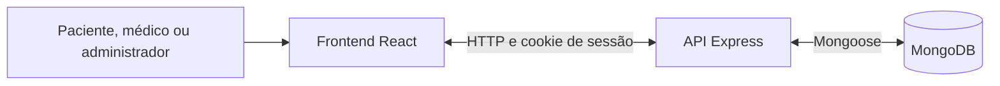

# MedTrack

Aplicação web para organizar a preparação de consultas médicas e o acompanhamento após o atendimento. Pacientes registram sintomas e dúvidas, médicos gerenciam consultas e orientações, e ambos acompanham as informações em uma plataforma integrada.

**Status:** projeto acadêmico concluído · Desenvolvimento Web · Universidade de Fortaleza — UNIFOR.

[Acessar o MedTrack](https://medtrackapp.vercel.app) · [Testes automatizados](medtrack-tests/)

## Funcionalidades

### Pacientes

- Cadastro, login e edição dos dados pessoais, com data de nascimento e opções inclusivas de gênero.
- Solicitação de consultas e envio da preparação com motivo, sintomas, dúvidas e medicamentos em uso.
- Consulta ao histórico, aos horários confirmados e às orientações do médico.
- Solicitação de remarcação e resposta às propostas de reagendamento do profissional.
- Registro de acompanhamentos após o atendimento.

### Médicos

- Cadastro profissional com especialidade, CRM e UF.
- Agenda mensal com identificação dos dias com consultas.
- Análise das solicitações, definição de horários, conclusão e cancelamento de consultas.
- Proposta de reagendamento com confirmação pelo paciente.
- Acesso aos resumos dos pacientes vinculados e registro de orientações.

### Administração

- Listagem de usuários e edição de nome e e-mail.
- Acesso administrativo às áreas de paciente e médico.
- Autorizações verificadas pela API conforme o perfil e o vínculo com os registros.

A interface inclui homepage pública, navegação responsiva, busca textual de consultas e pacientes e atualização periódica dos dados clínicos.

## Reagendamento com confirmação

O médico pode propor um novo horário em **Agenda → Detalhes → Reagendar consulta**. O paciente recebe um aviso no aplicativo e escolhe aceitar ou recusar.

O horário confirmado é mantido até o aceite. Se o paciente recusar, a consulta permanece no horário anterior. O novo horário é validado novamente na confirmação, impedindo duas consultas aceitas para o mesmo médico, dia e hora. Enquanto houver proposta pendente, o sistema aguarda a resposta antes de permitir outra remarcação ou a conclusão do atendimento.

Os avisos são exibidos dentro do MedTrack. Os dados são atualizados após as operações, ao retornar à janela e a cada 30 segundos enquanto a área clínica estiver ativa e visível.

## Tecnologias e arquitetura

| Camada | Tecnologias |
| --- | --- |
| Frontend | React, Vite, React Router, Bootstrap, React Bootstrap e Sass |
| Comunicação | Axios, HTTP e JSON |
| Backend | Node.js e Express |
| Banco de dados | MongoDB Atlas e Mongoose |
| Autenticação | Sessões persistidas no banco, cookies HTTP-only e hash de senha com `scrypt` |
| Testes | Postman, Playwright e executor nativo `node:test` |
| Hospedagem | Vercel, com serviços de frontend e API |



O frontend acessa a API; somente o backend estabelece a conexão com o banco. Em desenvolvimento, o Vite encaminha `/api` para a porta 3000. Na hospedagem, o roteamento dos serviços é definido em [`vercel.json`](vercel.json).

### Dados e permissões

As coleções `users`, `sessions`, `appointments`, `followups` e `guidances` armazenam usuários, sessões, consultas, acompanhamentos e orientações. A preparação e a proposta de reagendamento são subdocumentos da consulta. Os modelos e índices estão em [`backend/src/models.js`](backend/src/models.js).

O cadastro público permite os perfis `patient` e `doctor`. O perfil `admin` possui acesso administrativo e não aparece como profissional disponível para receber consultas.

Data de nascimento, gênero e especialidade são opcionais. Quando informado, o CRM exige a UF correspondente. Essa validação confere o formato dos campos; não realiza verificação no conselho profissional.

## Estrutura do repositório

```text
MedTrack/
├── backend/
│   ├── src/                   # API, autenticação, regras e modelos
│   ├── test/                  # Testes de integração
│   └── .env.example
├── frontend/
│   ├── src/                   # Páginas, componentes e serviços
│   ├── tests/example.spec.js  # Suíte executável do Playwright
│   ├── playwright.config.js
│   └── .env.example
├── medtrack-tests/
│   ├── MedTrack-Postman.json
│   └── MedTrack-Playwright.spec.js
├── vercel.json
└── README.md
```

## Executar localmente

### Pré-requisitos

- Node.js 22.13.0 ou superior e npm.
- MongoDB local em execução ou acesso a um cluster MongoDB Atlas.
- No Atlas, usuário do banco configurado e IP da máquina autorizado.

Clone o repositório:

```bash
git clone https://github.com/gabrmascarenhas/MedTrack.git
cd MedTrack
```

### Backend

No primeiro terminal:

```bash
cd backend
npm ci
```

Na primeira configuração, copie `.env.example` para `.env`. Preserve o arquivo se ele já estiver configurado. Ajuste a conexão com seu banco:

```dotenv
MONGODB_URI=mongodb://127.0.0.1:27017/medtrack
PORT=3000
HOST=127.0.0.1
NODE_ENV=development
```

Para utilizar o Atlas, substitua `MONGODB_URI` pela conexão do seu cluster, incluindo o nome do banco. Inicie a API:

```bash
npm run server
```

A API estará em `http://127.0.0.1:3000`. A rota `GET /api/health` retorna `{"ok":true,"db":"mongodb"}` quando a conexão com o banco está disponível. Use `npm run dev` para reiniciar automaticamente após alterações no backend.

### Frontend

No segundo terminal, a partir da raiz do repositório:

```bash
cd frontend
npm ci --include=dev
```

Na primeira configuração, copie `.env.example` para `.env`, preservando configurações existentes. Para utilizar a API real:

```dotenv
VITE_API_URL=/api
VITE_USE_MOCK=false
```

Inicie a interface:

```bash
npm run dev
```

Acesse `http://127.0.0.1:5173` e mantenha os dois servidores em execução. Após alterar o `.env` do frontend, reinicie o Vite.

## Testes

Os arquivos para consulta estão reunidos em [`medtrack-tests`](medtrack-tests/). As suítes cobrem fluxos de autenticação, permissões, cadastro, consultas e reagendamento, incluindo aceite e recusa pelo paciente.

### Postman

Importe [`MedTrack-Postman.json`](medtrack-tests/MedTrack-Postman.json) e configure `baseUrl` como `http://127.0.0.1:3000/api` no ambiente local.

As requisições manuais de login usam `qaEmailPaciente`, `qaSenhaPaciente`, `qaEmailMedico`, `qaSenhaMedico`, `qaEmailAdmin` e `qaSenhaAdmin`. Preencha essas variáveis somente no seu ambiente do Postman. Execute os cenários na ordem, pois as requisições compartilham IDs e sessões.

### Playwright

O arquivo executável está em [`frontend/tests/example.spec.js`](frontend/tests/example.spec.js). A versão em `medtrack-tests` é uma cópia para consulta.

Com frontend e backend locais ligados, execute dentro de `frontend`:

```bash
npx playwright install
npx playwright test example.spec.js --project=chromium --headed --workers=1
```

A suíte reúne dez cenários de interface. Para abrir o relatório da execução:

```bash
npx playwright show-report
```

### Integração da API

Os testes [`flow.test.js`](backend/test/flow.test.js) e [`reschedule.test.js`](backend/test/reschedule.test.js) verificam o fluxo de consultas e as regras de reagendamento, incluindo autorização, conflitos de horário e respostas concorrentes.

Dentro de `backend`, configure um banco separado chamado `medtrack_test`:

```bash
MONGODB_URI_TEST='mongodb://127.0.0.1:27017/medtrack_test' npm test
```

Sem essa variável, os testes de integração são ignorados. Os testes de Postman e Playwright criam dados fictícios no banco utilizado pela API; para novas rodadas, utilize uma instância conectada a um banco de testes separado.

## Publicação

O MedTrack está configurado para publicação na Vercel a partir da raiz do repositório, com os serviços `web` e `api` declarados em `vercel.json`. As atualizações da branch de produção conectada ao projeto geram novos deployments.

As variáveis do servidor incluem `MONGODB_URI` e `APP_ORIGIN`, correspondente à origem pública do site. O frontend utiliza `VITE_API_URL=/api` e `VITE_USE_MOCK=false`. A instalação do frontend inclui as dependências de desenvolvimento necessárias à compilação.

Credenciais devem permanecer nas variáveis de ambiente. Os arquivos `.env`, as dependências instaladas e os artefatos de compilação são ignorados pelo Git. Variáveis com prefixo `VITE_` são públicas no navegador e não devem conter senhas ou chaves privadas.

## Equipe

| Integrante | Responsabilidade |
| --- | --- |
| Gabriel Meneses | Gerenciamento do projeto |
| Yuri Freitas | Design e UX/UI |
| Pedro Átila | Frontend |
| Fernando José | Backend |
| Gabriel Mascarenhas | QA e análise de testes |

## Contexto acadêmico

Projeto concluído para a disciplina de Desenvolvimento Web do curso de Ciência da Computação da Universidade de Fortaleza — UNIFOR.

O MedTrack organiza informações relacionadas ao atendimento. Não realiza diagnósticos, não prescreve tratamentos e não substitui a avaliação de um profissional de saúde.
